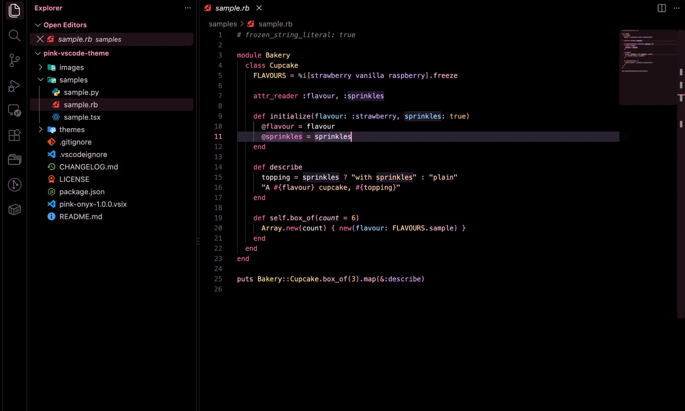
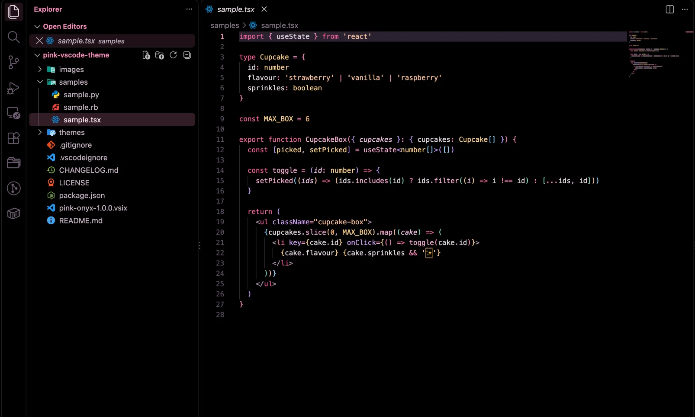
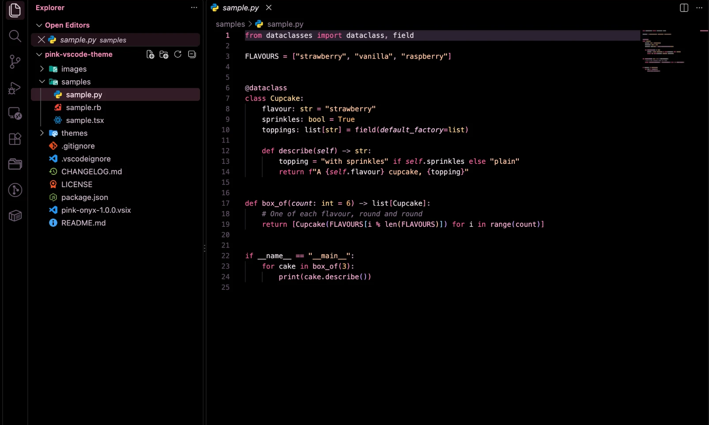

# Pink Onyx

Soft bubblegum pink on pure black. A cute dark theme that's easy on the eyes for long coding days.



## What it looks like

- **Pure black** editor, sidebar, tabs and terminal
- **Bubblegum pink** accents: section titles, selected files, tab underlines, badges and the cursor
- **Hot pink** keywords, **gold** class names, **lavender** symbols, **peach** strings and soft italic comments
- **Pink, green and red** change markers, so your uncommitted edits are easy to spot
- Matching **terminal** colours





## Install

1. Open the Extensions view (`Cmd+Shift+X` on Mac, `Ctrl+Shift+X` on Windows/Linux)
2. Search for **Pink Onyx** and click **Install**
3. Open the theme picker (`Cmd+K Cmd+T` / `Ctrl+K Ctrl+T`) and choose **Pink Onyx**

## Make the change markers even easier to see

VS Code draws the change markers as a thin, dashed bar by default. Add this to your `settings.json` for a wide, solid bar:

```json
"scm.diffDecorationsGutterWidth": 5,
"scm.diffDecorationsGutterPattern": { "added": false, "modified": false }
```

## Pairs well with

[Material Icon Theme](https://marketplace.visualstudio.com/items?itemName=PKief.material-icon-theme), with soft rose folders:

```json
"material-icon-theme.folders.color": "#F5B3CE"
```

## Licence

MIT
